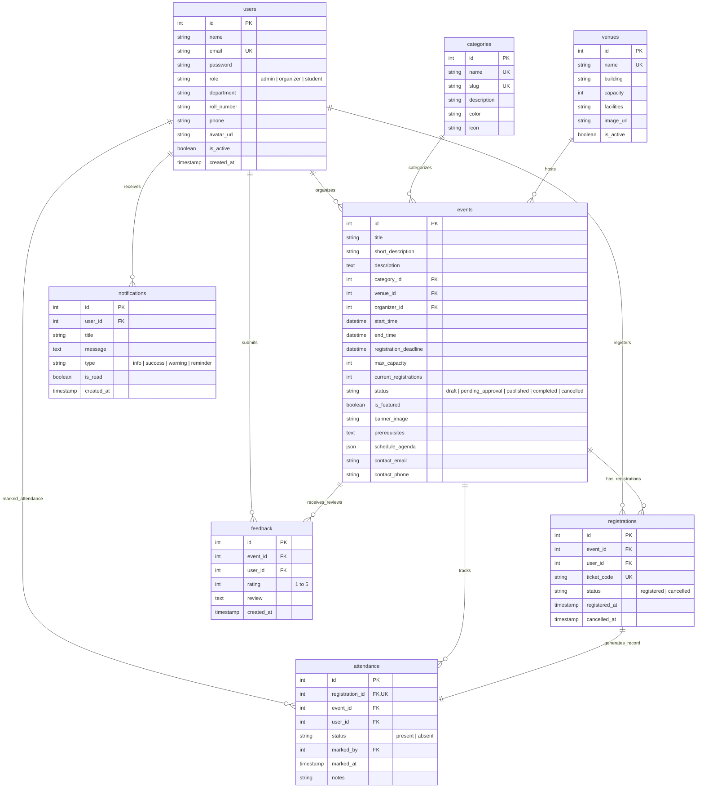

# CampusPulse Database Architecture & Schema Design

## 1. Entity-Relationship Diagram (ERD)

---

## 2. Table Specifications & Indexes

### 2.1 `users` Table
- **Primary Key:** `id` (AUTO_INCREMENT)
- **Unique Keys:** `email`
- **Indexes:** `idx_user_role` (`role`), `idx_user_email` (`email`)
- **Roles:**
  - `admin`: Full platform governance, user activation, venue management, and event approvals.
  - `organizer`: Event authoring, attendee management, and live attendance tracking.
  - `student`: Event browsing, registration, ticket passes, and feedback review submission.

### 2.2 `events` Table
- **Primary Key:** `id` (AUTO_INCREMENT)
- **Foreign Keys:**
  - `category_id` -> `categories(id)` ON DELETE RESTRICT
  - `venue_id` -> `venues(id)` ON DELETE RESTRICT
  - `organizer_id` -> `users(id)` ON DELETE CASCADE
- **Indexes:** `idx_event_status` (`status`), `idx_event_dates` (`start_time`, `end_time`), `idx_event_featured` (`is_featured`)
- **Capacity Integrity:** `max_capacity` is constrained to not exceed `venues.capacity`.

### 2.3 `registrations` Table
- **Primary Key:** `id` (AUTO_INCREMENT)
- **Foreign Keys:**
  - `event_id` -> `events(id)` ON DELETE CASCADE
  - `user_id` -> `users(id)` ON DELETE CASCADE
- **Unique Constraint:** `uq_event_user` (`event_id`, `user_id`) prevents double bookings.
- **Ticket Code:** Unique, human-readable identifier (e.g. `CP-8A19-4821`) used for QR code generation and entrance verification.

### 2.4 `attendance` Table
- **Primary Key:** `id` (AUTO_INCREMENT)
- **Foreign Keys:**
  - `registration_id` -> `registrations(id)` ON DELETE CASCADE (Unique)
  - `event_id` -> `events(id)` ON DELETE CASCADE
  - `user_id` -> `users(id)` ON DELETE CASCADE
  - `marked_by` -> `users(id)` ON DELETE RESTRICT
- **Statuses:** `present` or `absent` with exact check-in timestamp.

### 2.5 `feedback` Table
- **Primary Key:** `id` (AUTO_INCREMENT)
- **Foreign Keys:**
  - `event_id` -> `events(id)` ON DELETE CASCADE
  - `user_id` -> `users(id)` ON DELETE CASCADE
- **Unique Constraint:** `uq_feedback_event_user` (`event_id`, `user_id`) ensures one review per student per event.
- **Rating Check:** `CHECK (rating >= 1 AND rating <= 5)`.

---

## 3. Dual-Engine Storage Architecture

CampusPulse features a dual-engine database layer (`server/src/database/db.js`):
1. **Production MySQL 8.0+ / MariaDB 10.4+:**
   - Full ACID transactional compliance.
   - InnoDB engine with utf8mb4 collation.
   - Connection pooling via `mysql2/promise`.
2. **Built-in Node.js v22+ SQLite Engine:**
   - Automatically activates when MySQL service is offline or unreachable on `localhost:3306`.
   - Requires zero installation or external binaries.
   - Executes identical relational schemas, foreign key cascades, and queries.
